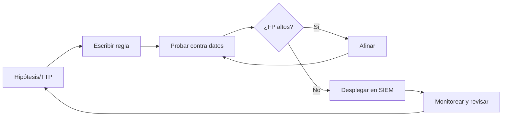

# 🎯 Detection Engineering

La ingeniería de detección es **escribir y mejorar las reglas** que detectan ataques. Es donde el Blue Team pasa de "reaccionar" a "construir" sus propias defensas.

## El objetivo

Una buena detección:

- **Detecta** lo malicioso (pocos falsos negativos).
- **No se dispara** con lo normal (pocos falsos positivos).
- Es **mantenible** y está mapeada a [MITRE ATT&CK](threat-intel.md).

```text
        detecta lo malo
             ▲
   ideal →   │   ● 
             │
             └───────────►  no molesta con lo normal
```

<a id="sigma"></a>

## Sigma — reglas de detección portables

[Sigma](https://github.com/SigmaHQ/sigma) es un formato **genérico** para reglas de detección sobre logs. Escribís la regla una vez y la convertís al lenguaje de tu [SIEM](siem.md) (Splunk, Elastic, etc.). Es "el YARA de los logs".

```yaml
title: Muchos logins fallidos (posible fuerza bruta)
logsource:
  product: windows
  service: security
detection:
  selection:
    EventID: 4625
  timeframe: 5m
  condition: selection | count() > 20
level: high
tags:
  - attack.credential_access
  - attack.t1110
```

➡️ Más ejemplos en la carpeta [`sigma/`](https://github.com/robilotteba/notes/tree/main/docs/blueteam/sigma) del repo.

## YARA — reglas para identificar malware

[YARA](https://virustotal.github.io/yara/) identifica archivos maliciosos por **patrones** (strings, bytes, estructura). Muy usado para clasificar muestras de malware.

```yara
rule Ejemplo_Malware_Generico
{
    meta:
        description = "Detecta un patrón de ejemplo"
        author = "robilotteba"
    strings:
        $a = "cadena_sospechosa"
        $b = { 6A 40 68 00 30 00 00 }   // bytes de ejemplo
    condition:
        $a or $b
}
```

➡️ Más ejemplos en la carpeta [`yara/`](https://github.com/robilotteba/notes/tree/main/docs/blueteam/yara) del repo.

## El ciclo de la detección



## Buenas prácticas

- Mapeá cada detección a una **técnica de ATT&CK**.
- Documentá: qué detecta, por qué, y qué hacer si salta (link a un [playbook](ir.md)).
- Versioná las reglas (¡por eso viven en Git!).
- Medí y bajá los **falsos positivos** continuamente.

---

### Para profundizar

- [SigmaHQ](https://github.com/SigmaHQ/sigma) — miles de reglas de la comunidad
- [YARA docs](https://yara.readthedocs.io/)
- [Detection Engineering (Florian Roth, varios artículos)](https://www.nextron-systems.com/blog/)
- [The DFIR Report](https://thedfirreport.com/) — ataques reales con detecciones
