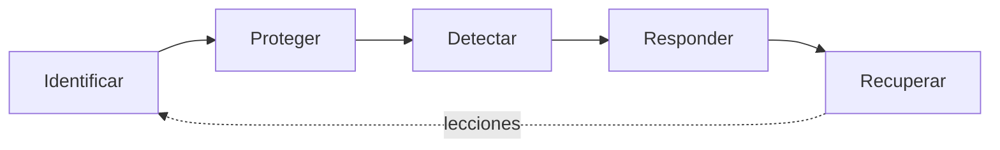

# 🔵 Blue Team

Seguridad **defensiva**: monitorear, detectar, responder y recuperar. Mientras el Red Team busca entrar, el Blue Team se asegura de **verlo y frenarlo**.

-   **🏢 SOC**

    ---
    Qué es un Security Operations Center y cómo trabaja.

    [:octicons-arrow-right-24: Ver](soc.md)

-   **📊 SIEM**

    ---
    Centralizar y correlacionar logs: Splunk, Elastic, Wazuh.

    [:octicons-arrow-right-24: Ver](siem.md)

-   **🪵 Análisis de logs**

    ---
    Leer logs de Windows y Linux. Los Event ID que importan.

    [:octicons-arrow-right-24: Ver](logs.md)

-   **🌐 Análisis de red**

    ---
    Tráfico, capturas y detección de anomalías.

    [:octicons-arrow-right-24: Ver](red.md)

-   **🚨 Respuesta a incidentes**

    ---
    El ciclo de IR y playbooks.

    [:octicons-arrow-right-24: Ver](ir.md)

-   **🧠 Threat Intelligence**

    ---
    IOCs, TTPs y MITRE ATT&CK.

    [:octicons-arrow-right-24: Ver](threat-intel.md)

-   **🔬 Forense**

    ---
    Investigar qué pasó tras un incidente.

    [:octicons-arrow-right-24: Ver](forense.md)

-   **🎯 Detection Engineering**

    ---
    Escribir reglas de detección (Sigma, YARA).

    [:octicons-arrow-right-24: Ver](detection.md)

-   **🛠️ Herramientas**

    ---
    Wireshark, Sysmon, Suricata, Volatility y más.

    [:octicons-arrow-right-24: Ver](herramientas.md)

## Las funciones del defensor (NIST CSF)

| Función | Qué implica |
|---|---|
| **Identificar** | Conocer tus activos y riesgos |
| **Proteger** | Controles para reducir la superficie de ataque |
| **Detectar** | Monitoreo, alertas, [SIEM](siem.md) |
| **Responder** | [Respuesta a incidentes](ir.md) |
| **Recuperar** | Volver a la normalidad y aprender |
