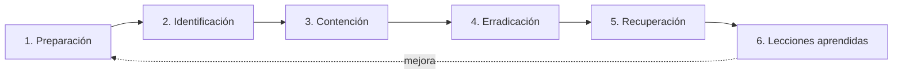

# 🚨 Respuesta a incidentes (IR)

La respuesta a incidentes es el **proceso ordenado** para manejar un ataque: desde que se detecta hasta que se aprende de él. Tener un método evita improvisar en el peor momento.

## El ciclo de IR (SANS / NIST)



| Fase | Qué se hace |
|---|---|
| **1. Preparación** | Herramientas, playbooks, contactos, backups listos **antes** del incidente |
| **2. Identificación** | Confirmar que es un incidente real y su alcance |
| **3. Contención** | Frenar la propagación (aislar hosts, cortar accesos) sin destruir evidencia |
| **4. Erradicación** | Eliminar la causa (malware, cuentas comprometidas, persistencia) |
| **5. Recuperación** | Restaurar servicios y verificar que todo está limpio |
| **6. Lecciones** | Post-mortem: qué falló, qué mejorar |

## Contención: short-term vs long-term

- **Corto plazo:** aislar la máquina de la red **ya** para frenar el daño.
- **Largo plazo:** parches, reglas nuevas, reconstrucción limpia.

!!! warning "No destruyas evidencia"
    Apagar una máquina o borrar archivos puede eliminar evidencia valiosa (memoria RAM, timestamps). Si va a haber [análisis forense](forense.md), primero se preserva, después se limpia.

## Playbooks

Un **playbook** es un procedimiento paso a paso para un tipo concreto de incidente. Tener playbooks acelera la respuesta y la hace consistente.

Ejemplos de playbooks útiles:

- **Phishing reportado** → analizar el correo, extraer IOCs, buscar otros afectados, bloquear remitente/URLs.
- **Malware en un endpoint** → aislar host, identificar la familia, buscar propagación, limpiar o reinstalar.
- **Cuenta comprometida** → forzar cambio de contraseña, revocar sesiones, revisar actividad reciente.
- **Fuerza bruta exitosa** → bloquear IP, resetear credencial, revisar qué hizo el atacante.

➡️ Tengo una [plantilla de playbook](#plantilla-de-playbook) abajo.

## Roles durante un incidente

- **Incident Commander:** coordina y decide.
- **Analistas:** investigan y ejecutan.
- **Comunicación:** informa a stakeholders/legal/management.

## Plantilla de playbook

```markdown
# Playbook: [Tipo de incidente]

## Disparador
Qué alerta/condición activa este playbook.

## Severidad
Criterios para clasificar (baja / media / alta / crítica).

## Pasos
1. Identificación: ...
2. Contención: ...
3. Erradicación: ...
4. Recuperación: ...

## Evidencia a recolectar
- Logs de ...
- Capturas de ...

## Escalamiento
A quién y cuándo escalar.
```

---

### Para profundizar

- [NIST SP 800-61 — Computer Security Incident Handling Guide](https://csrc.nist.gov/pubs/sp/800/61/r2/final)
- [SANS Incident Handler's Handbook](https://www.sans.org/white-papers/33901/)
- TryHackMe — rooms de *Incident Response*
