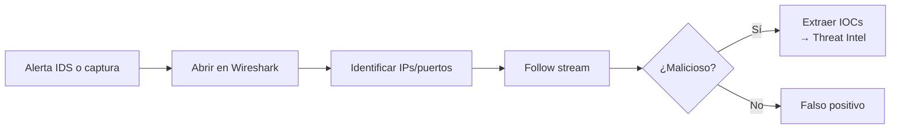

# 🌐 Análisis de red

Analizar el tráfico de red permite **ver lo que pasa en el cable**: quién habla con quién, con qué protocolo y si hay algo anómalo. Es clave para detectar intrusiones, exfiltración y malware.

## Dos formas de mirar la red

| Enfoque | Qué es | Herramienta típica |
|---|---|---|
| **Full packet capture** | Guardar paquetes completos para analizarlos | [Wireshark](herramientas.md#wireshark), tcpdump |
| **IDS/IPS** | Reglas que detectan (IDS) o bloquean (IPS) tráfico malicioso en vivo | [Suricata](herramientas.md), Snort, Zeek |

## Wireshark — lo esencial

[Wireshark](herramientas.md#wireshark) abre capturas (`.pcap`) y las muestra paquete por paquete.

Filtros de display más usados:

```text
ip.addr == 10.0.0.5          # tráfico de/hacia una IP
http                         # solo HTTP
dns                          # solo DNS
tcp.port == 445              # SMB
http.request.method == "POST"
```

!!! tip "Follow TCP Stream"
    Clic derecho sobre un paquete → *Follow → TCP Stream* reconstruye toda la conversación. Es lo primero que uso para entender qué se intercambió.

## Qué busco en el tráfico

- **Escaneos de puertos:** muchos SYN a puertos distintos desde una IP ([recon del Red Team](../redteam/reconocimiento.md) visto del otro lado).
- **Fuerza bruta:** muchas conexiones repetidas a SSH/RDP/web.
- **Exfiltración:** transferencias salientes grandes o a destinos raros.
- **DNS sospechoso:** consultas a dominios random (posible C2/tunneling).
- **Texto plano:** credenciales viajando sin cifrar (HTTP, FTP, Telnet).
- **Beaconing:** conexiones periódicas y regulares a un mismo destino (patrón de C2).

## IDS/IPS y reglas

Un IDS como **Suricata** o **Snort** usa reglas para alertar. Ejemplo conceptual de regla:

```text
alert tcp any any -> any 445 (msg:"Posible explotación SMB"; ...)
```

**Zeek** (antes Bro) genera logs riquísimos del tráfico (conexiones, DNS, HTTP, archivos), muy usados en threat hunting.

## Flujo de una investigación de red



➡️ Los IOCs que extraés alimentan la [Threat Intelligence](threat-intel.md).

---

### Para profundizar

- [Wireshark — User Guide](https://www.wireshark.org/docs/)
- [Malware Traffic Analysis](https://www.malware-traffic-analysis.net/) — ejercicios con pcaps reales
- TryHackMe — rooms *Wireshark*, *Snort*, *Zeek*
