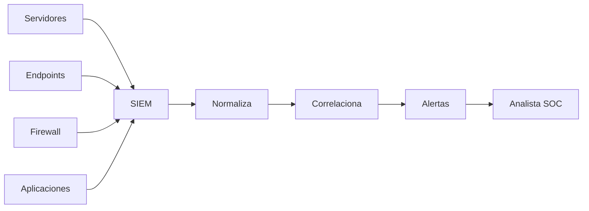

# 📊 SIEM

Un **SIEM** (Security Information and Event Management) centraliza los **logs** de toda la organización, los **correlaciona** y **genera alertas** cuando detecta algo sospechoso. Es el corazón tecnológico del [SOC](soc.md).

## Qué hace un SIEM



1. **Recolecta** logs de muchas fuentes.
2. **Normaliza**: los pone en un formato común.
3. **Correlaciona**: cruza eventos (ej. "100 logins fallidos y después uno exitoso").
4. **Alerta**: dispara según reglas de detección.
5. **Permite investigar**: búsquedas, dashboards, timelines.

## Los SIEM más comunes

| SIEM | Notas |
|---|---|
| **Splunk** | Muy potente y usado en empresas. Lenguaje de búsqueda SPL. Hay versión free para practicar. |
| **Elastic (ELK)** | Elasticsearch + Logstash + Kibana. Open source, muy popular. |
| **Wazuh** | Open source, combina SIEM + XDR/HIDS. **Ideal para montar un lab casero gratis.** |
| **Microsoft Sentinel** | SIEM cloud de Azure. |

!!! tip "Mi plan de lab"
    Montar **Wazuh** en una VM, conectarle un par de endpoints (un Windows y un Linux) y practicar generando eventos y viendo cómo aparecen. Es la mejor forma de aprender SIEM sin pagar nada.

## Correlación: el ejemplo clásico

Un solo login fallido no es nada. Pero el SIEM puede detectar patrones:

```text
Regla: "Posible fuerza bruta"
  SI   > 20 eventos 4625 (login fallido)
  DESDE la misma IP
  EN    < 2 minutos
  SEGUIDO de un 4624 (login exitoso)
  ENTONCES → alerta de severidad alta
```

Esto se construye con [detection engineering](detection.md) y reglas tipo [Sigma](detection.md#sigma).

## Qué aprender de un SIEM

1. **Buscar/filtrar** eventos (el lenguaje de consulta de cada uno).
2. Construir **dashboards**.
3. Entender las **fuentes de log** y qué registra cada una.
4. Escribir y ajustar **reglas de alerta** (bajar falsos positivos).

---

### Para profundizar

- [Wazuh — documentación](https://documentation.wazuh.com/)
- [Splunk Free](https://www.splunk.com/en_us/download/splunk-enterprise.html) + TryHackMe room *Splunk*
- TryHackMe — rooms *Introduction to SIEM*, *Splunk*, *Elastic*
