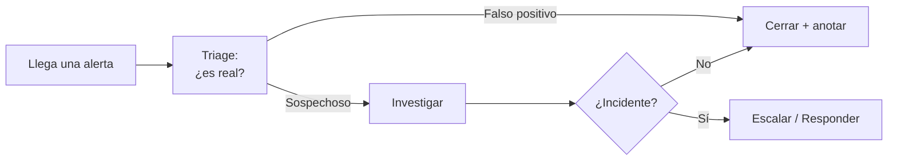

# 🏢 SOC — Security Operations Center

Un **SOC** es el equipo (y el conjunto de procesos y tecnología) que **monitorea una organización 24/7** para detectar y responder a incidentes de seguridad. Es la puerta de entrada más común a una carrera en Blue Team.

## Niveles del SOC

| Nivel | Rol | Qué hace |
|---|---|---|
| **L1 — Analista** | Triage | Monitorea alertas, hace el primer filtrado, escala lo relevante |
| **L2 — Analista** | Investigación | Investiga a fondo, confirma incidentes, contiene |
| **L3 — Especialista** | Threat hunting / IR | Caza amenazas, responde incidentes complejos, mejora detecciones |
| **SOC Manager** | Coordinación | Gestiona el equipo, métricas, procesos |

!!! tip "Dónde empezar"
    El puesto de entrada es **Analista SOC L1**. El path [SOC Level 1 de TryHackMe](../academies/tryhackme.md) está pensado justo para eso.

## El flujo de trabajo de un analista

## Triage: la habilidad central del L1

Ante una alerta, el analista se pregunta:

- **¿Qué** disparó la alerta? (regla, IOC, comportamiento)
- **¿Quién/qué** está involucrado? (usuario, host, IP)
- **¿Cuándo** pasó y si sigue pasando.
- **¿Es un falso positivo?** (la mayoría lo son).
- **¿Cuál es el impacto** potencial?

La mayor parte del trabajo es **separar el ruido de lo real** sin perder lo importante.

## Conceptos que vas a escuchar todo el tiempo

| Término | Significado |
|---|---|
| **IOC** | Indicator of Compromise: una IP, hash, dominio malicioso |
| **TTP** | Tácticas, Técnicas y Procedimientos del atacante ([MITRE ATT&CK](threat-intel.md)) |
| **Falso positivo** | Alerta que parecía maliciosa pero no lo era |
| **Falso negativo** | Algo malicioso que **no** se detectó (lo peor) |
| **MTTD / MTTR** | Tiempo medio de detección / respuesta (métricas clave) |
| **Playbook** | Procedimiento paso a paso para un tipo de incidente |

## Herramientas del día a día

- **[SIEM](siem.md)** → donde llegan y se correlacionan los logs.
- **EDR** → detección y respuesta en los endpoints.
- **[Threat Intel](threat-intel.md)** → para enriquecer alertas (¿esta IP es conocida como maliciosa?).
- **Ticketing** → para registrar y seguir cada caso.

---

### Para profundizar

- TryHackMe — path *SOC Level 1*
- [Blue Team Labs Online](https://blueteamlabs.online/)
- [LetsDefend](https://letsdefend.io/) — simula el trabajo real de un SOC
