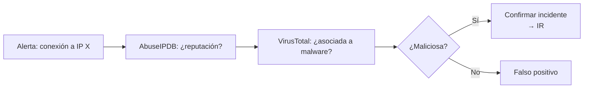

# 🧠 Threat Intelligence

La inteligencia de amenazas es **conocer al enemigo**: quiénes atacan, cómo y con qué. Convierte datos sueltos en contexto para tomar mejores decisiones defensivas.

## IOCs vs TTPs

| | IOC | TTP |
|---|---|---|
| Qué es | Indicador concreto de compromiso | Táctica, Técnica y Procedimiento del atacante |
| Ejemplos | IP, hash, dominio, URL maliciosa | "Usa phishing con macros → persistencia por tarea programada" |
| Duración | Efímero (cambian fácil) | Más estable (el comportamiento cuesta cambiarlo) |

!!! quote "Pyramid of Pain"
    Cuanto más arriba en la pirámide detectás al atacante (TTPs en vez de hashes/IPs), **más le duele** y más difícil le es evadirte. Bloquear un hash es trivial de sortear; detectar su *comportamiento*, no.

## MITRE ATT&CK

[MITRE ATT&CK](https://attack.mitre.org/) es el marco de referencia: un catálogo de **tácticas** (el *por qué*: el objetivo) y **técnicas** (el *cómo*) que usan los atacantes reales.

Tácticas (columnas de la matriz), en orden aproximado:

```text
Reconnaissance → Initial Access → Execution → Persistence →
Privilege Escalation → Defense Evasion → Credential Access →
Discovery → Lateral Movement → Collection → C2 → Exfiltration → Impact
```

Sirve para:

- **Mapear** detecciones: ¿qué técnicas cubro y cuáles no?
- **Comunicar** en un lenguaje común (ej. "T1566 = Phishing").
- Guiar el **threat hunting**.

## Fuentes y herramientas

- **[VirusTotal](https://www.virustotal.com/):** analizar hashes/URLs/archivos contra decenas de motores.
- **[AbuseIPDB](https://www.abuseipdb.com/):** reputación de IPs.
- **[URLScan](https://urlscan.io/):** analizar URLs sospechosas de forma segura.
- **[MISP](https://www.misp-project.org/):** plataforma para compartir intel.
- **OSINT feeds:** listas de IOCs comunitarias.

## Enriquecer una alerta (ejemplo de flujo)



## Threat hunting

Buscar **proactivamente** amenazas que las alertas automáticas no detectaron, partiendo de una hipótesis ("si un atacante hiciera X, vería Y en mis logs"). Se apoya mucho en MITRE ATT&CK y en [análisis de logs](logs.md).

---

### Para profundizar

- [MITRE ATT&CK](https://attack.mitre.org/) · [ATT&CK Navigator](https://mitre-attack.github.io/attack-navigator/)
- TryHackMe — rooms *MITRE*, *Threat Intelligence Tools*, *Cyber Kill Chain*
