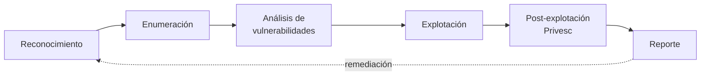

# 🔴 Red Team

Seguridad **ofensiva**: pensar como un atacante para encontrar y demostrar debilidades, siempre en entornos autorizados. El objetivo real no es "romper" sino **entender el riesgo y cómo remediarlo**.

!!! warning "Uso educativo y legal"
    Todo lo de esta sección se practica en [TryHackMe](../academies/tryhackme.md), [HackMyVM](../academies/hackmyvm.md) y labs propios. Atacar sistemas sin autorización por escrito es delito.

-   **🧭 Metodología**

    ---
    Las fases de un pentest y cómo encaro una máquina.

    [:octicons-arrow-right-24: Ver](metodologia.md)

-   **🔎 Reconocimiento**

    ---
    Descubrir qué hay: hosts, puertos, servicios.

    [:octicons-arrow-right-24: Ver](reconocimiento.md)

-   **🛠️ Herramientas**

    ---
    Qué es cada herramienta y para qué sirve.

    [:octicons-arrow-right-24: Ver](herramientas.md)

-   **🌐 Web Pentest**

    ---
    El OWASP Top 10 explicado.

    [:octicons-arrow-right-24: Ver](web.md)

-   **🖧 Network Pentest**

    ---
    Enumeración de servicios de red.

    [:octicons-arrow-right-24: Ver](network.md)

-   **⬆️ Privilege Escalation**

    ---
    De usuario común a root/admin.

    [:octicons-arrow-right-24: Ver](privesc.md)

-   **☁️ Cloud Pentest**

    ---
    Seguridad en AWS/Azure/GCP.

    [:octicons-arrow-right-24: Ver](cloud.md)

-   **🧬 Pwn & Reversing**

    ---
    Binarios, assembly e ingeniería inversa.

    [:octicons-arrow-right-24: Ver](pwn.md)

-   **🎭 Social Engineering**

    ---
    El factor humano: phishing y concienciación.

    [:octicons-arrow-right-24: Ver](social.md)

## El ciclo, en una imagen

