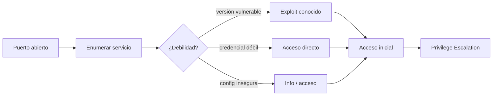

# 🖧 Network Pentest

Una vez que el [reconocimiento](reconocimiento.md) te dice qué puertos están abiertos, toca **enumerar cada servicio** para entender qué ofrece y dónde puede fallar.

## Pentest por puertos / servicios

La idea: a cada servicio, su enumeración específica.

| Puerto | Servicio | Qué enumerar |
|:--:|---|---|
| 21 | FTP | ¿Permite login anónimo? ¿Versión vulnerable? |
| 22 | SSH | Versión, métodos de autenticación, usuarios válidos |
| 25 | SMTP | Usuarios válidos (verificación), versión |
| 53 | DNS | Transferencia de zona, subdominios |
| 80/443 | HTTP(S) | → [Web Pentest](web.md) |
| 139/445 | SMB | Recursos compartidos, usuarios, versión |
| 3306 | MySQL | Credenciales por defecto, acceso remoto |
| 3389 | RDP | Versión, credenciales |

## SMB (muy común en CTFs y AD)

SMB comparte archivos e impresoras en redes Windows. Es una mina de información:

- **Recursos compartidos** accesibles sin credenciales.
- **Usuarios** del dominio.
- **Versión** del servicio (relevante para vulnerabilidades conocidas).

Herramientas típicas: `smbclient`, `enum4linux-ng`, `NetExec` (antes CrackMapExec).

```bash
smbclient -L //10.10.10.10 -N      # listar shares sin credenciales
enum4linux-ng 10.10.10.10          # enumeración automática
```

## Servicios con credenciales por defecto

Muchísimos servicios se dejan con credenciales de fábrica (`admin:admin`, etc.). Siempre vale probar las documentadas por el fabricante antes de asumir que hace falta "hackear" algo.

## De la red al acceso

El patrón general en una máquina:



➡️ Después del acceso inicial: [Escalada de privilegios](privesc.md).

---

### Para profundizar

- [HackTricks — Pentesting por servicio/puerto](https://book.hacktricks.xyz/)
- TryHackMe — rooms *Network Services 1 & 2*, *Enumeration*
