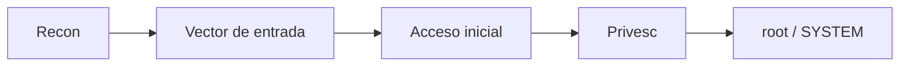

# 📝 Plantilla de writeup

> Copiá esta página para cada máquina nueva. Borrá estas dos líneas al empezar.

---

# [Nombre de la máquina] — [Plataforma]

| | |
|---|---|
| **Plataforma** | TryHackMe / HackMyVM / Lab propio |
| **Dificultad** | Easy / Medium / Hard |
| **SO** | Linux / Windows |
| **Fecha** | AAAA-MM-DD |
| **Tags** | `web`, `smb`, `privesc`, ... |

## 🎯 Resumen

Un párrafo: cómo se resuelve la máquina de principio a fin (el "camino").



## 🔎 Reconocimiento

Qué puertos y servicios encontré.

```text
(salida resumida del escaneo)
```

**Observaciones:** ...

## 🧭 Enumeración

Lo que fui descubriendo en cada servicio.

- Servicio X: ...
- Servicio Y: ...

## 🚪 Acceso inicial

Cómo obtuve el primer acceso y **por qué** funcionó (la causa raíz).

!!! note "Vulnerabilidad"
    Tipo de fallo + por qué existía.

## ⬆️ Escalada de privilegios

Cómo pasé a root/administrador.

- Vector encontrado: ...
- Por qué era explotable: ...

## 🏴 Flags

| Flag | Ubicación |
|---|---|
| user | `...` |
| root | `...` |

## 🧠 Lo que aprendí

- ...
- ...

## 🛡️ Cómo se remediaría

Qué debería hacer el administrador para cerrar estos fallos (la parte Blue Team).

- ...
